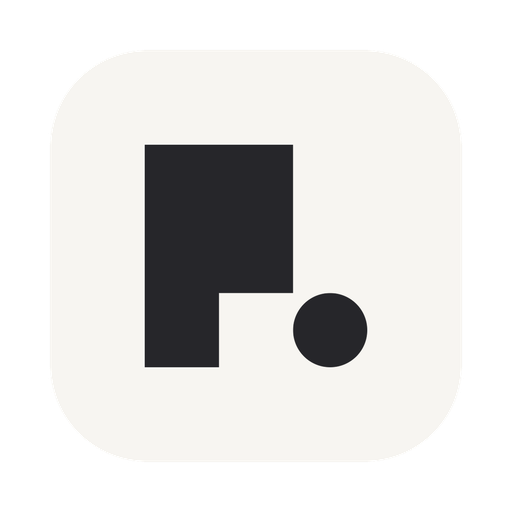
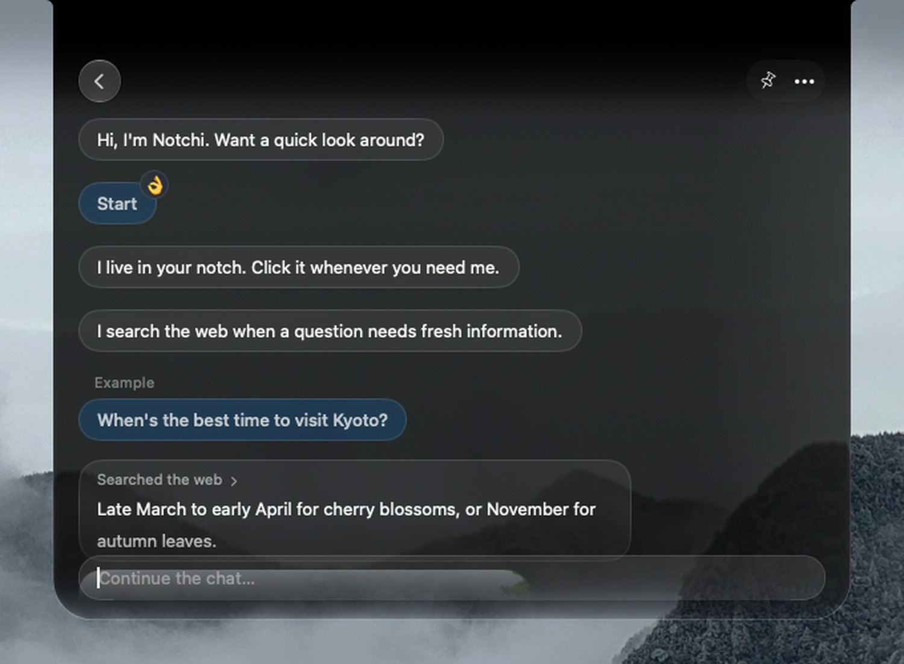
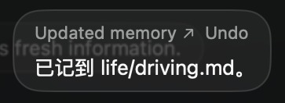
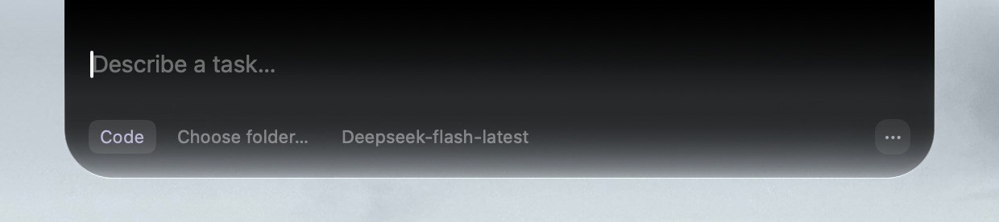
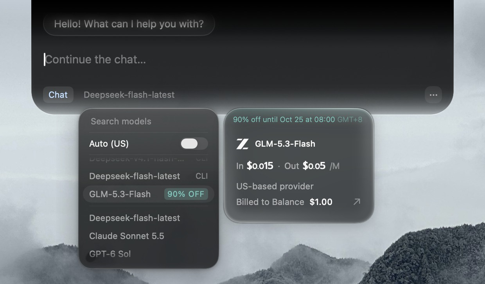
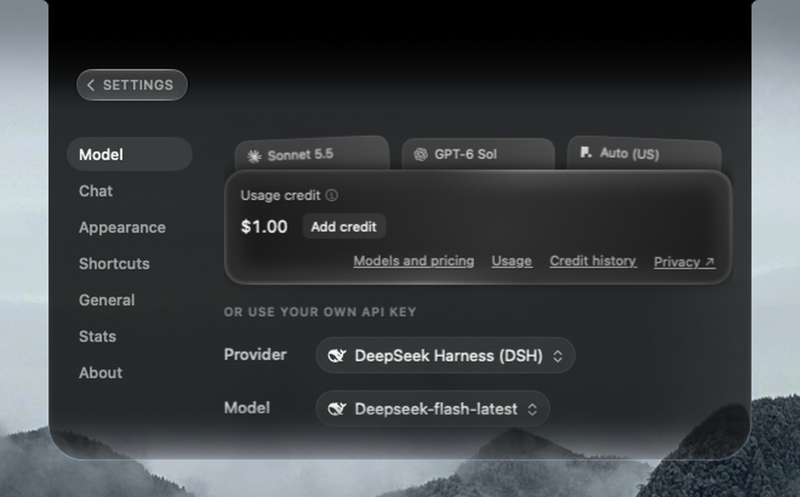
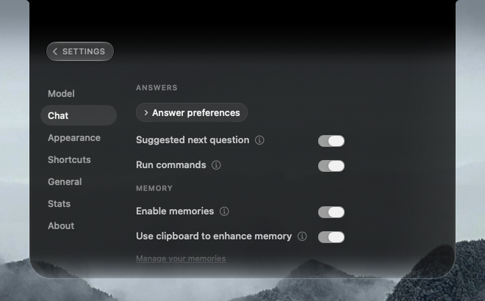
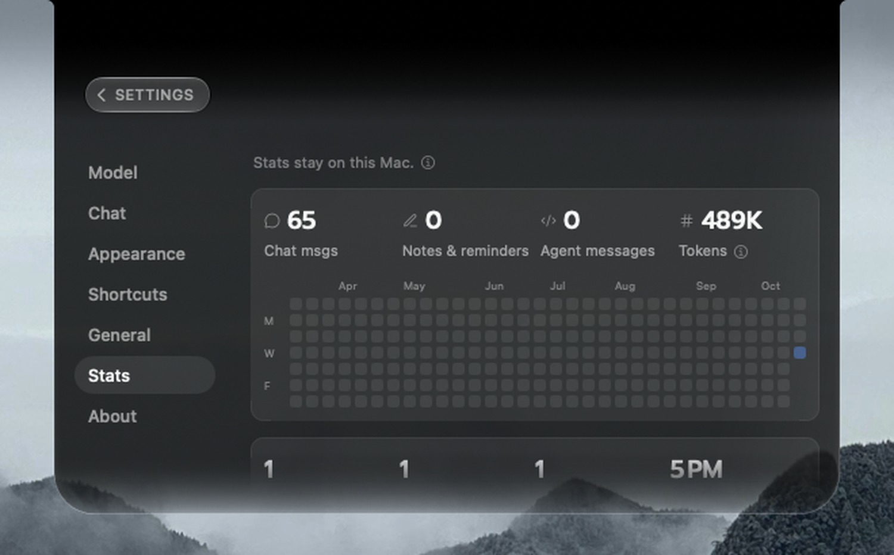
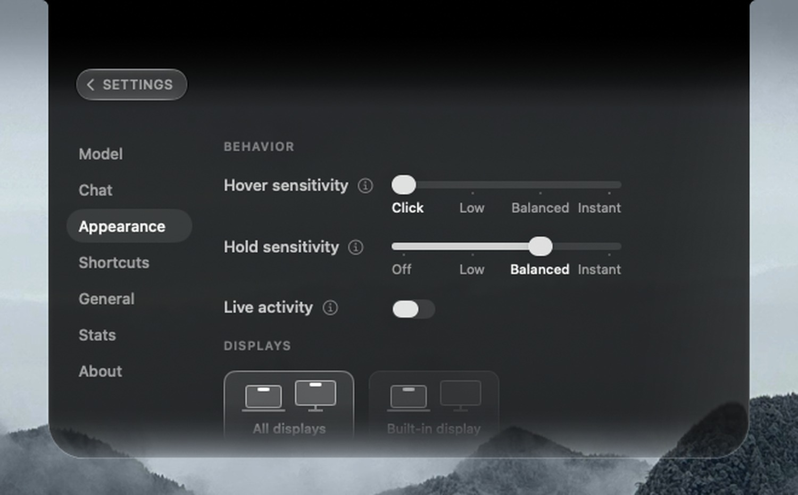
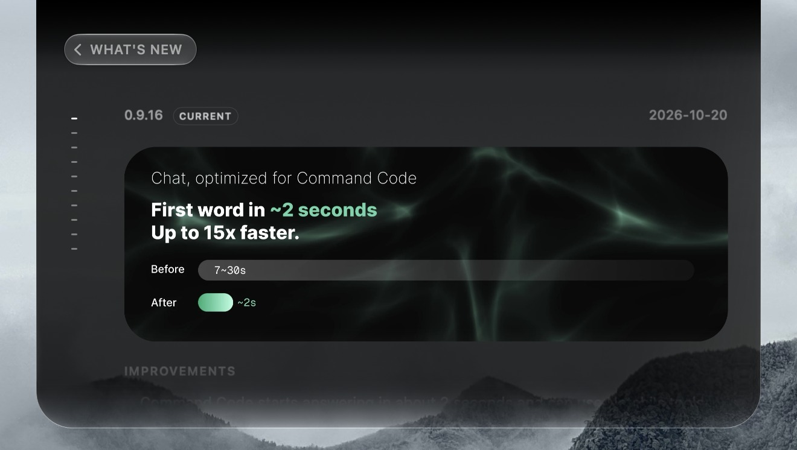

[English](README.md) · [简体中文](README.zh-CN.md)

<div align="center">



# Notchi

**A Personal AI in your Mac's notch. Open source and yours to control.**

Save **notes**, set **reminders**, **ask AI**, and **hand tasks to coding agents**, all from your Mac's notch.

[notch.website](https://notch.website) ·
[Pricing](https://notch.website/pricing) ·
[Release Notes](https://notch.website/releases) ·
[Docs](https://notch.website/docs)

MIT · Apple Liquid Glass

</div>

Notchi is a free, open-source macOS app that turns the MacBook notch into a place to type. A thought can become an Apple Note, a line with a time goes to Apple Reminders, a question goes to an AI model, and a larger software task runs through a coding-agent CLI on a project folder.

## Install

Via Homebrew:

```bash
brew install --cask cyrus-cai/lofi-lab/notchi
```

Installer script:

```bash
curl -fsSL https://raw.githubusercontent.com/cyrus-cai/notchi/master/install.sh | bash
```

Or hand it to **Claude Code / Codex**:

> Install Notchi on this Mac. Run `brew install --cask cyrus-cai/lofi-lab/notchi`, verify that `/Applications/Notchi.app` exists, then launch it. If Homebrew isn't available, tell me before installing anything else.

- Notchi requires **macOS 14 (Sonoma) or later**. A hardware notch is optional.
- Notchi currently ships un-notarized. If you have a Developer account and would like to help, write to [xiikii@outlook.com](mailto:xiikii@outlook.com?subject=An%20Apple%20Developer%20account%20for%20Notchi).

## What Notchi does

### Keep a thought

A line goes to Ask by default. Press Tab or start it with a colon to capture it instead: a line that names a time, like "call mum tomorrow 9am", is scheduled in Apple Reminders; anything else is saved to Apple Notes (or a Markdown folder).

### Ask a question

The answer arrives in the notch as a conversation you can keep going. It can search the live web with sources, read a copied screenshot, and calculate exact results. Notchi remembers what you said, and when you said it.



When you tell Notchi something worth keeping, it saves it to memory and says so in the reply. Undo removes it.



### Hand off a task

Point Notchi at a project folder and run **Codex**, **Claude Code**, **Cursor**, **Grok**, or **pi** in the background. The closed notch shows progress and elapsed time, and you can send follow-up instructions when the run finishes.



### Anywhere you select text

Long press (force click) selected text in any app, or press a bound shortcut, to translate, proofread, reply, or run any prompt on it. The answer opens beside the pointer.

## Our models, or yours

The app is free. Pay per use, or bring your own.

- **Notchi models**: pay per token from a prepaid Notchi Balance, top-ups from $1, no subscription, bought credit doesn't expire. No API key needed.
- **Your own key**: OpenRouter, Vercel AI Gateway, OpenAI, Anthropic, Google Gemini, DeepSeek, Qwen, Kimi, GLM, MiniMax, MiMo, or any OpenAI-compatible endpoint (Ollama, LM Studio, vLLM, self-hosted gateways).
- **Signed-in CLI**: Codex, Claude Code, Cursor, Grok, or pi, on your own plan.

Switch models from the notch. The picker shows each model's price per million tokens and any discount.



Settings → Model shows your balance and holds your own key.



See [Pricing](https://notch.website/pricing) for model prices and details.

## Privacy

- **No sign-up.** No email, no password. At launch Notchi registers an anonymous account that only holds your Notchi Balance.
- **Prompts aren't kept.** Requests to Notchi's own models pass through Notchi's gateway, which records the model, token counts, and charge, not what you asked or what the model answered.
- **Your own key or CLI goes direct.** Those requests go straight from your Mac to that provider and are billed by it.
- Notes, reminders, local history, clipboard contents, and local files stay on your Mac.
- Memories and usage stats are stored on your Mac. Memory can be turned off in Settings → Chat.

|  |  |
| --- | --- |

The full policy is at [notch.website/privacy](https://notch.website/privacy).

## Design

Notchi is drawn in macOS Liquid Glass, including the edge glow and physical motion of native macOS 26.

Settings → Appearance sets whether the notch opens on click, hover, or hold, and which displays it appears on.



## Questions

**Does Notchi work on a Mac without a notch?**

Yes. On Macs without a notch and on external displays, Notchi draws a virtual notch at the top of the display and behaves the same way.

**Is Notchi free?**

The app is free and open source. Notchi's own models are the one thing you pay for, from your Notchi Balance. You can use your own key or a signed-in CLI instead and never add credit.

**Can I use local models?**

Yes. Add any OpenAI-compatible endpoint in Settings → Model. A key is optional for custom endpoints.

**Why does Notchi ask for system permissions?**

Each permission is asked for the first time a feature needs it: Accessibility to read selected text, Notes automation, Reminders, Notifications, and clipboard access for Copy sensing. Notchi does not ask for Screen Recording, Microphone, Camera, or Location. Settings → General shows what is granted. See [Permissions](https://notch.website/permissions).

**How do I see what changed?**

What's New in the notch lists the changes in each version. The same notes are at [Release Notes](https://notch.website/releases).



**How do I uninstall Notchi?**

Run `brew uninstall --cask cyrus-cai/lofi-lab/notchi`.

## Developers

Open `NotchGlass.xcodeproj` (Xcode 16+), or run `./scripts/reinstall.sh`.

## License

Notchi is released under the [MIT License](LICENSE).
