[English](README.md) · [简体中文](README.zh-CN.md)

<div align="center">


# Notchi

**Your personal AI, 100% in your control.** Born in the Mac notch — now beyond it.

Built in Liquid Glass · Open source on GitHub

[notch.website](https://notch.website) ·
[Pricing](https://notch.website/pricing) ·
[Release Notes](https://notch.website/releases)

</div>

## Install via Homebrew

```bash
brew install --cask cyrus-cai/lofi-lab/notchi
```

Or copy a prompt for Claude Code:

> Please install Notchi for macOS for me. Run this in my terminal: brew install --cask cyrus-cai/lofi-lab/notchi
> It is a free, open-source menu-bar app (https://github.com/cyrus-cai/notchi). After it finishes, confirm Notchi is installed in /Applications and launch it.

**Ask** — Searches the web when needed

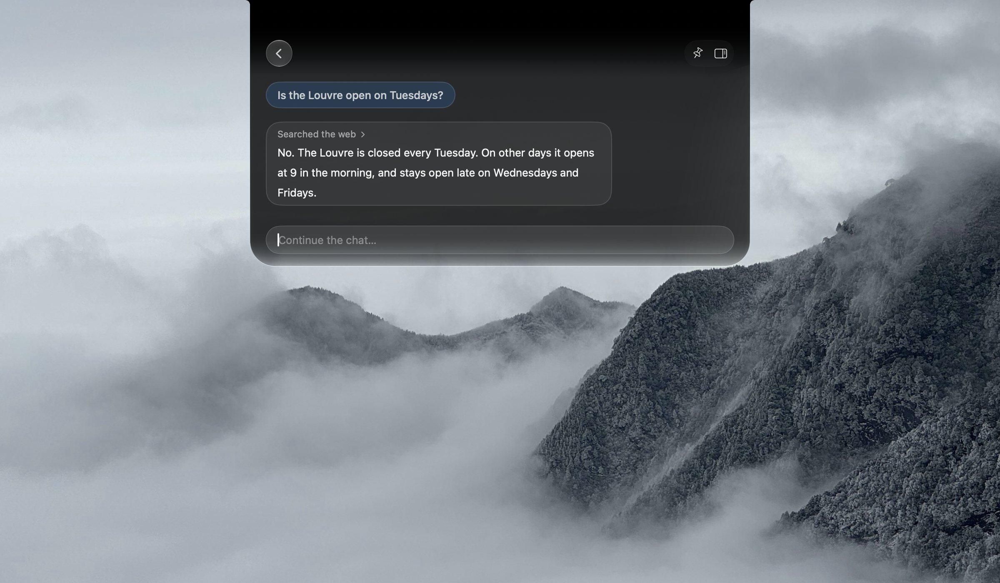

**Follow-up** — The last answer stays above the prompt

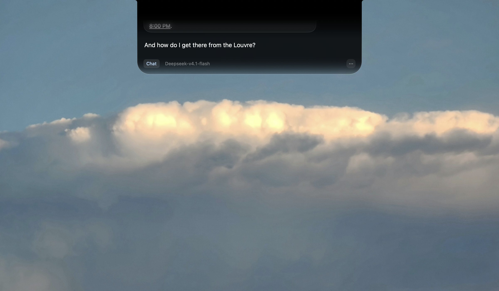

**Unified threads** — Every question in one conversation

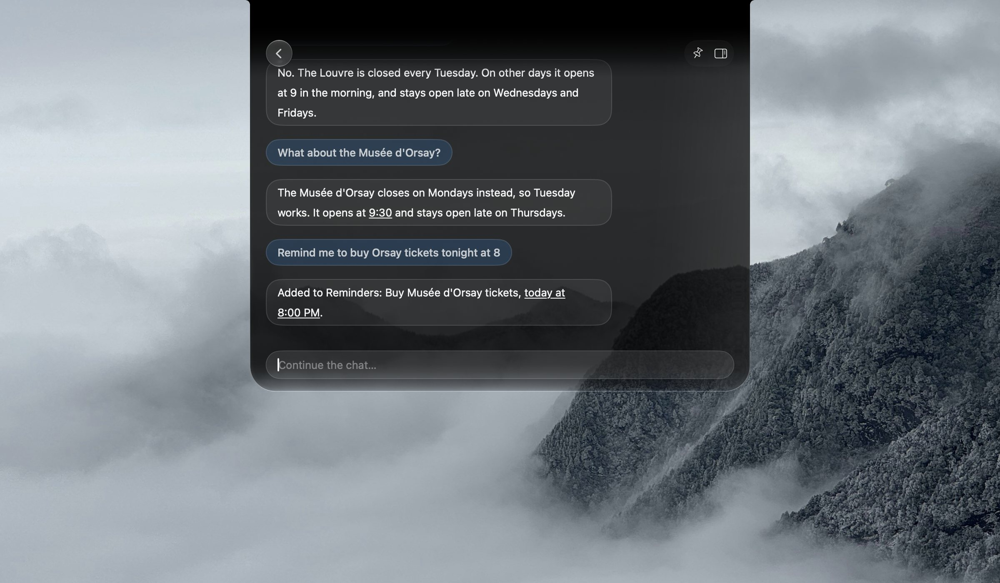

**Reminders** — Lines with a time go to Reminders

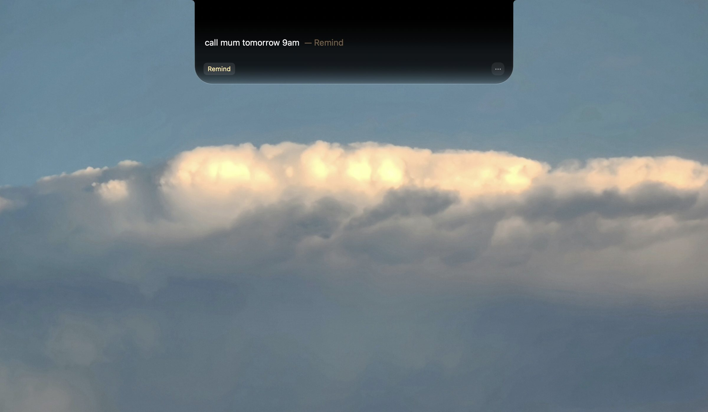

**Charts** — Numbers shown as charts

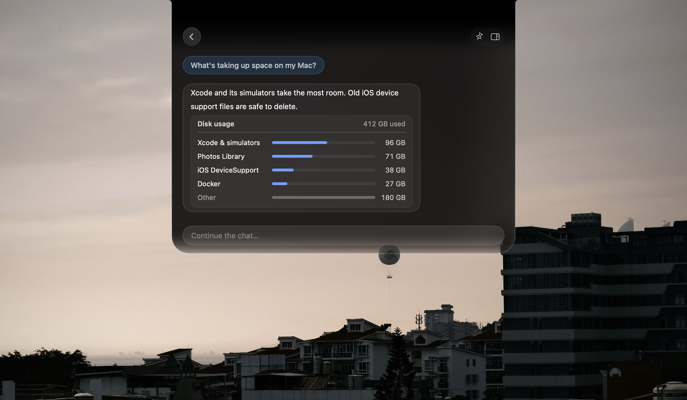

**Agents** — Hand a project to Codex, Claude Code or Cursor

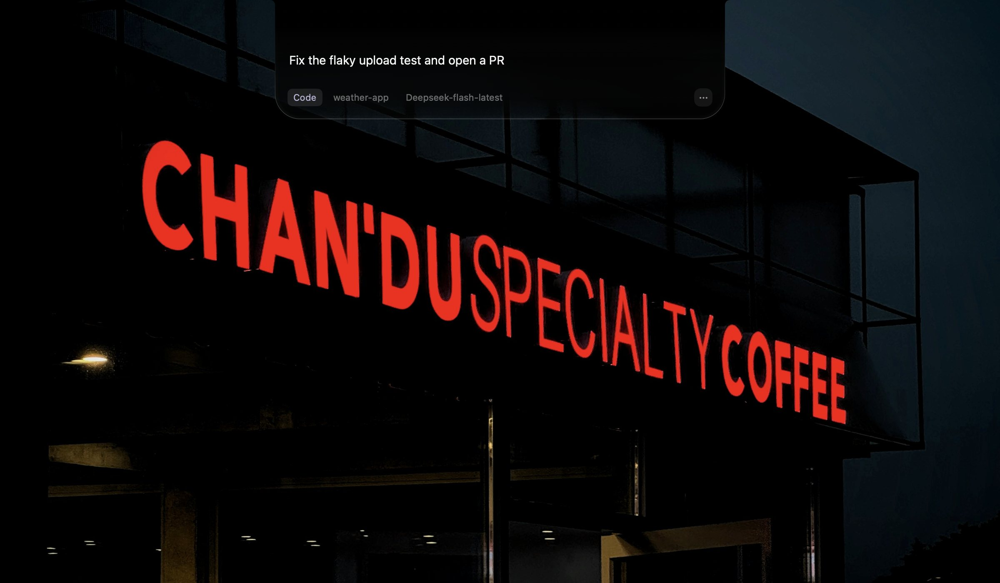

**Audit** — Every request Notchi sends

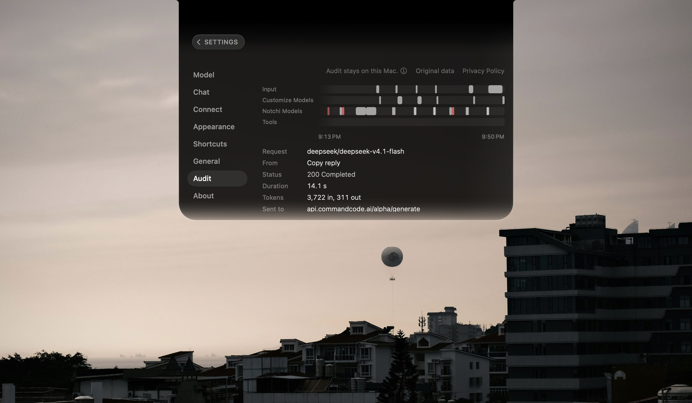

## 100% in your control

- **Local data** — Chats and memory stay on your Mac
- **No sign-up** — No email, no password
- **Bring your own key** — Connect your model provider directly, without Notchi in between
- **Auditable requests** — Settings → Audit lists every request Notchi sends

[Open source on GitHub ↗](https://github.com/cyrus-cai/notchi) · [Privacy policy →](https://notch.website/privacy)

## Designed details

| | |
| --- | --- |
| **Thinking states**<br>Designed animations while thinking, searching and running tools | 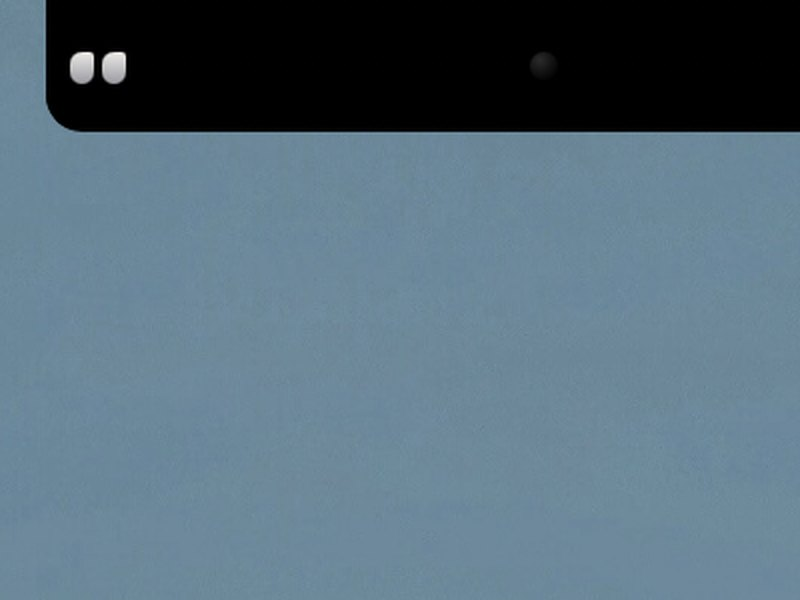<br>**Collapsed state**<br>Background tasks, tracked live |
| 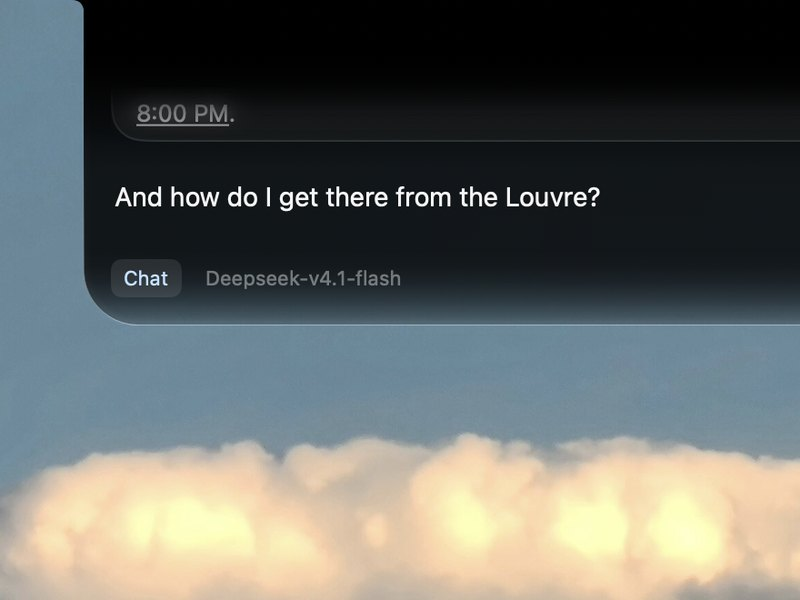<br>**Unified threads**<br>Continuous memory and history. The more you talk, the better it knows you | 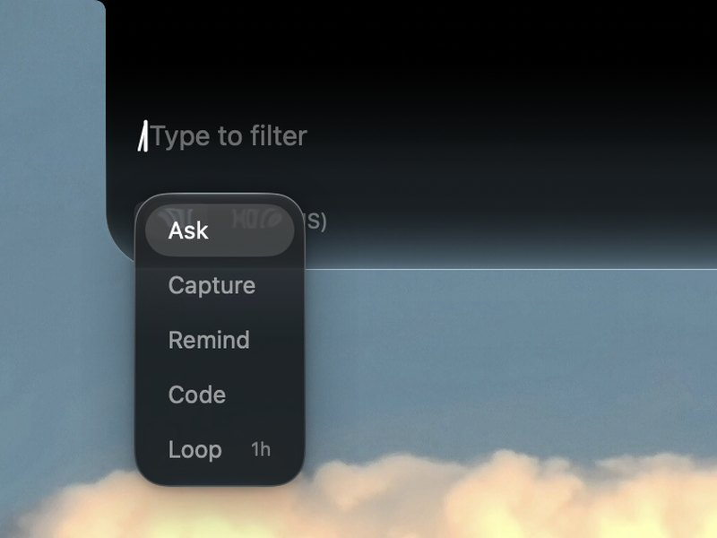<br>**Slash menu**<br>Save notes and reminders |
| 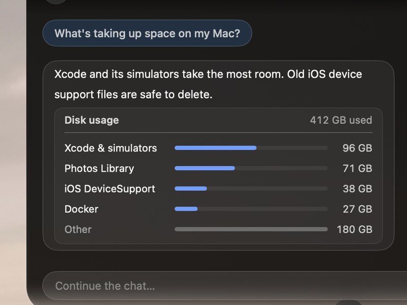<br>**Rich answers**<br>Visual charts | 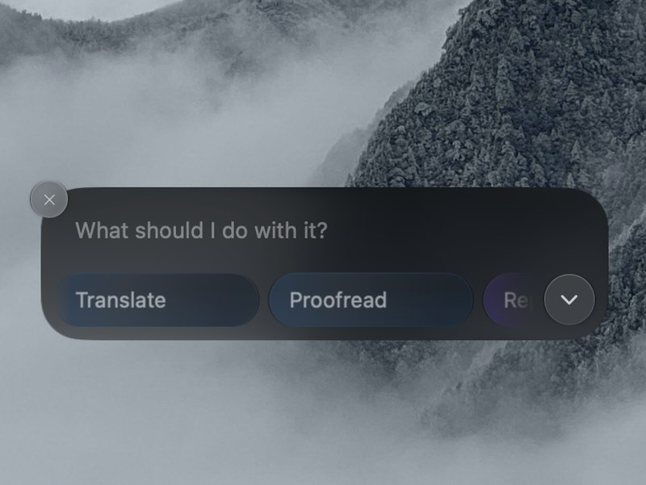<br>**Shortcuts**<br>Long-press for shortcuts and a prompt |
| 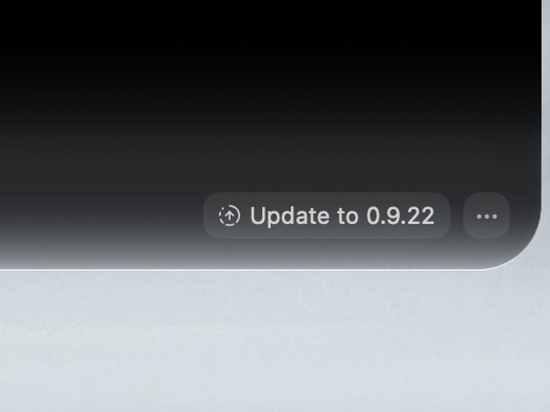<br>**App updates**<br>An update tag appears when a new version is out | 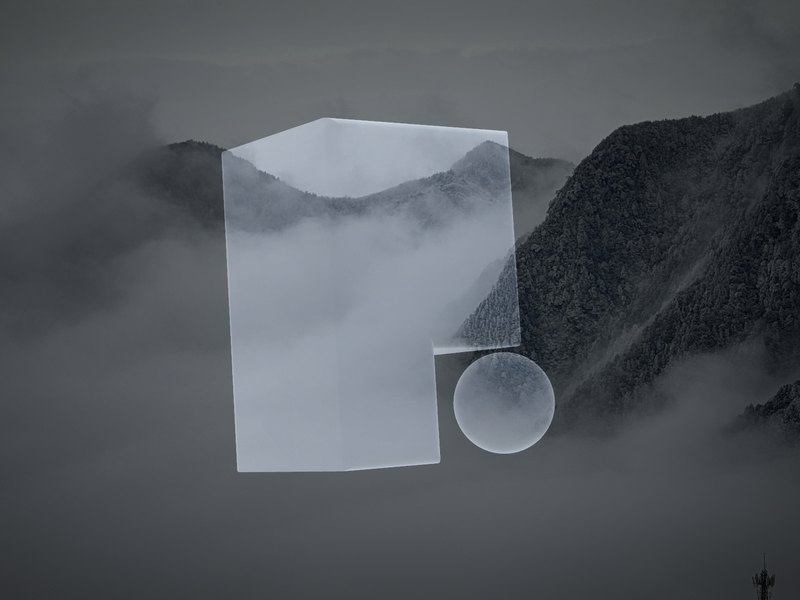<br>**3D launch animation**<br>A glass 3D mark on first launch |

## Unified threads

**Context memory** — Continuous memory and history. The more you talk, the better it knows you


**Runs commands** — Uses your Mac's system abilities to get tasks done on its own

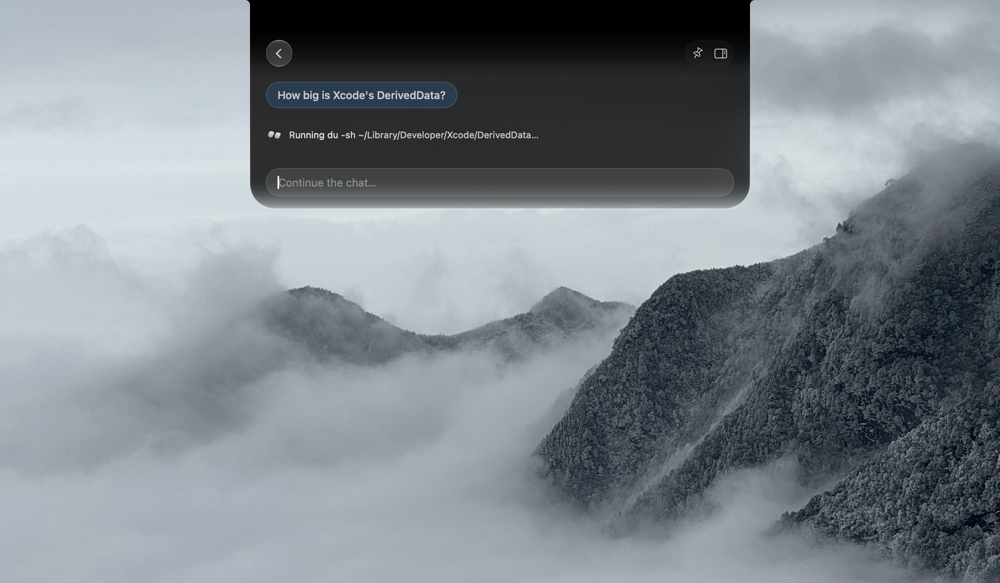

**Emoji reactions** — Reacts to your messages with an emoji

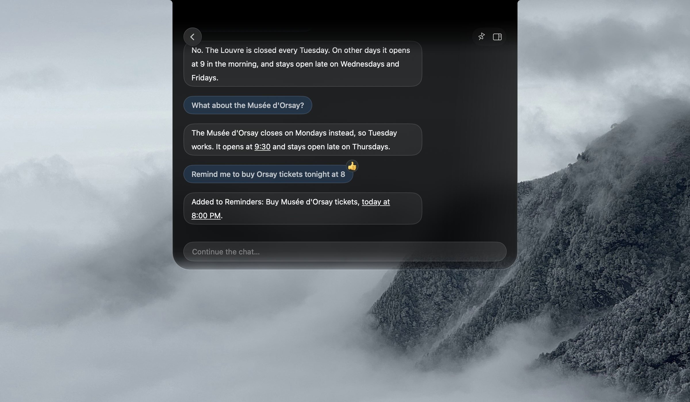

**Next question** — Suggests what you might ask next

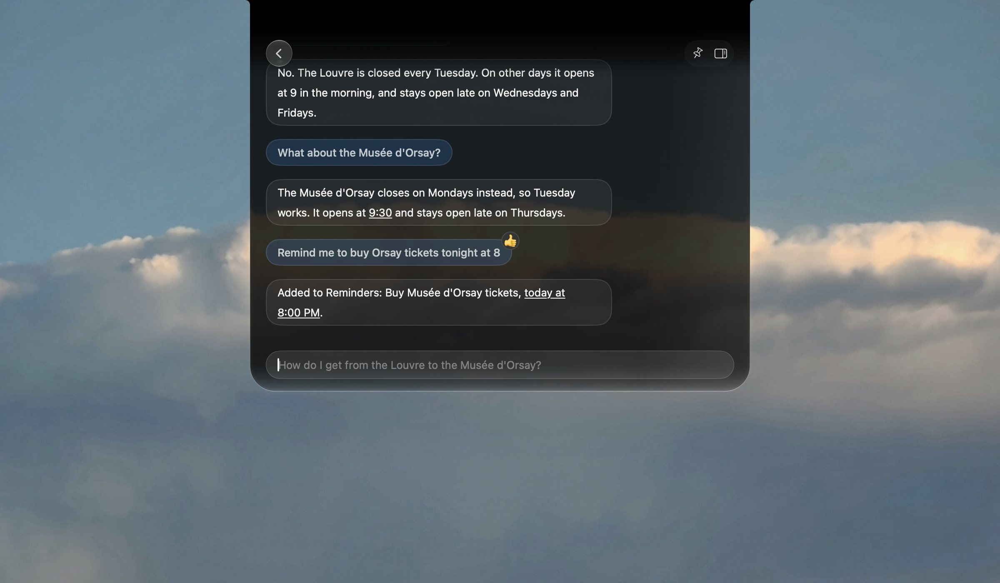

## Get Notchi

```bash
brew install --cask cyrus-cai/lofi-lab/notchi
```

---

**Product** [Pricing](https://notch.website/pricing) · [Release Notes](https://notch.website/releases) · [Download](https://notch.website/downloads)<br>
**Company** [About](https://notch.website/about) · [Privacy](https://notch.website/privacy) · [Terms of Use](https://notch.website/terms)<br>
**Connect** [GitHub](https://github.com/cyrus-cai/notchi) · [Issues](https://github.com/cyrus-cai/notchi/issues) · [X](https://x.com/cyrusss_7) · [Email](mailto:xiikii@outlook.com)

© 2026 Lofi Lab · [MIT License](LICENSE)
