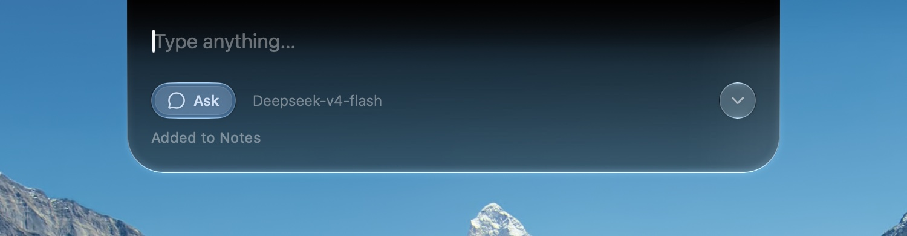
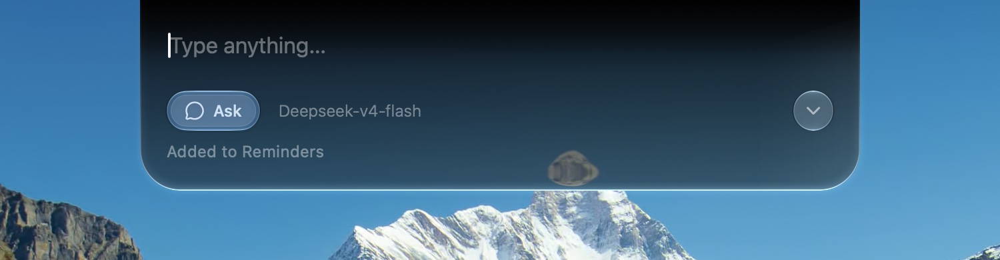
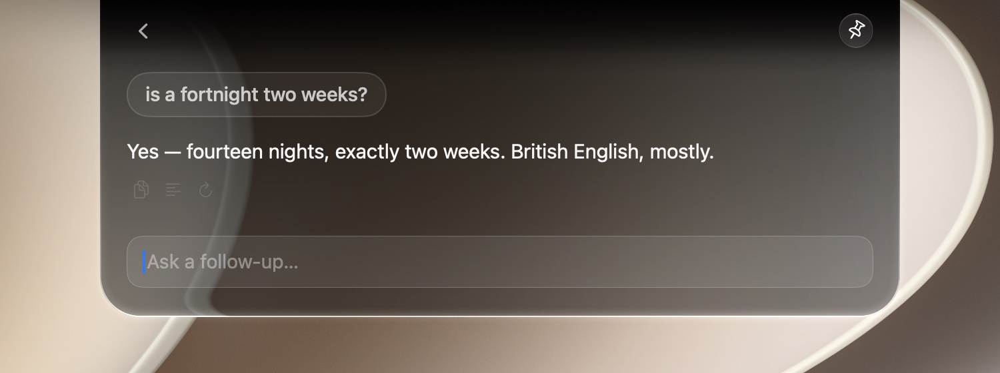
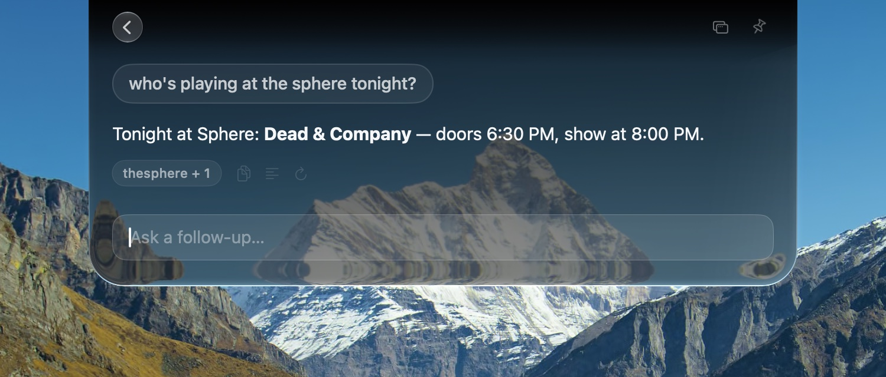
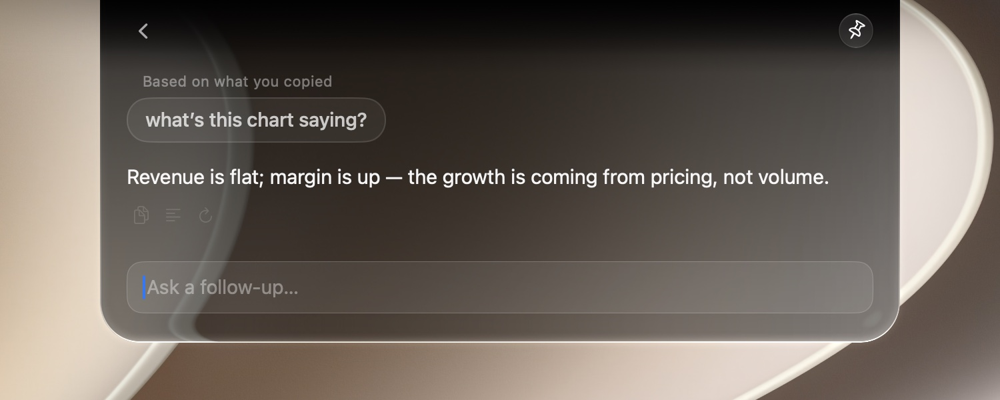
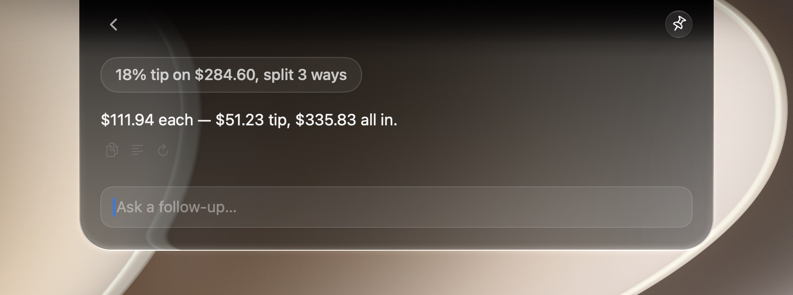
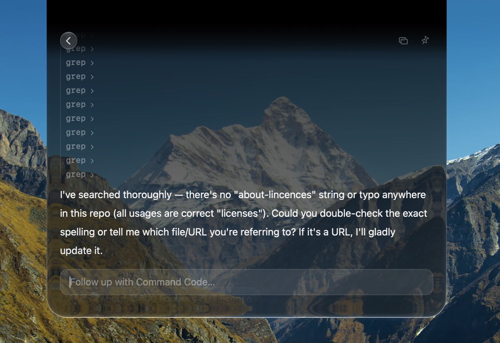

[English](README.md) · [简体中文](README.zh-CN.md)

<div align="center">


# Notchi

**Notchi 是 Mac 刘海里的个人 AI。开源，由你掌控。**

随手**记笔记**、**设提醒**、**问 AI**、**给 Agent 派活**，都在 Mac 的刘海里完成。

[notch.website](https://notch.website) ·
[定价](https://notch.website/pricing) ·
[更新日志](https://notch.website/releases) ·
[文档](https://notch.website/docs)

MIT · Apple Liquid Glass

</div>

Notchi 是一款免费、开源的 macOS 应用，把 MacBook 的刘海变成一个输入框。一个想法可以存进 Apple 备忘录，带时间的一句话会进入 Apple 提醒事项，问题会交给 AI 模型，更大的开发任务则由编程 Agent CLI 在项目文件夹里完成。

## 安装

通过 Homebrew：

```bash
brew install --cask cyrus-cai/lofi-lab/notchi
```

安装脚本：

```bash
curl -fsSL https://raw.githubusercontent.com/cyrus-cai/notchi/master/install.sh | bash
```

或者交给 **Claude Code / Codex**：

> 在这台 Mac 上安装 Notchi。运行 `brew install --cask cyrus-cai/lofi-lab/notchi`，确认 `/Applications/Notchi.app` 存在，然后启动它。如果没有 Homebrew，先告诉我，不要安装其他东西。

- Notchi 需要 **macOS 14（Sonoma）或更高版本**，有没有硬件刘海都可以。
- 目前应用尚未经过 Apple 公证。如果你有开发者账号并愿意协助，请发邮件到 [xiikii@outlook.com](mailto:xiikii@outlook.com?subject=An%20Apple%20Developer%20account%20for%20Notchi)。

## Notchi 能做什么

### 记下一个想法

输入的内容默认交给提问。按 Tab 或以冒号开头则改为记录：带时间的一句话（比如“明天早上 9 点给妈妈打电话”）会加入 Apple 提醒事项，其他内容存进 Apple 备忘录（或 Markdown 文件夹）。

|  |  |
| --- | --- |

### 提一个问题

答案以对话的形式出现在刘海里，可以接着问。它能联网搜索并给出来源，读取复制的截图，做精确计算。Notchi 记得你说过什么，也记得是哪天说的。



|  |  |
| --- | --- |



### 派一个任务

选一个项目文件夹，在后台运行 **Codex**、**Claude Code**、**Cursor**、**Grok** 或 **pi**。收起的刘海会显示进度和已用时间，运行结束后可以继续追加指令。




### 选中文字就能用

在任意 App 里长按（用力点按）选中的文字，或按下绑定的快捷键，就能翻译、润色、回复，或对它运行任意提示词。答案显示在指针旁边。

## 用我们的模型，或用你自己的

App 免费。按量付费，或者用你自己的。

- **Notchi 模型**：从预付的 Notchi 余额按 token 扣费，$1 起充，不用订阅，已购额度不过期，不需要 API Key。
- **自己的密钥**：OpenRouter、Vercel AI Gateway、OpenAI、Anthropic、Google Gemini、DeepSeek、Qwen、Kimi、GLM、MiniMax、MiMo，或任意 OpenAI 兼容端点（Ollama、LM Studio、vLLM、自建网关）。
- **已登录的 CLI**：Codex、Claude Code、Cursor、Grok 或 pi，用你自己的套餐。

模型价格和详情见[定价](https://notch.website/pricing)。

## 隐私

- **不用注册。** 没有邮箱和密码。启动时 Notchi 会注册一个匿名账户，只用来存放你的 Notchi 余额。
- **不保存提问内容。** 发给 Notchi 自有模型的请求会经过 Notchi 的网关，网关只记录模型、token 数和扣费，不记录你问了什么、模型答了什么。
- **自己的密钥或 CLI 直连。** 这些请求从你的 Mac 直接发到对应服务商，由服务商计费。
- 笔记、提醒、本地历史、剪贴板内容和本地文件都留在你的 Mac 上。

完整政策见 [notch.website/privacy](https://notch.website/privacy)。

## 设计

Notchi 用 macOS Liquid Glass 绘制，包括 macOS 26 原生风格的边缘光感和物理动效。

## 常见问题

**没有刘海的 Mac 能用吗？**

能。在没有刘海的 Mac 和外接显示器上，Notchi 会在屏幕顶部绘制一个虚拟刘海，用法相同。

**Notchi 免费吗？**

App 免费且开源。唯一需要付费的是 Notchi 自有模型，从 Notchi 余额里扣。你也可以只用自己的密钥或已登录的 CLI，从不充值。

**能用本地模型吗？**

能。在设置 → 模型中添加任意 OpenAI 兼容端点，自定义端点的密钥是可选的。

**为什么 Notchi 要请求系统权限？**

每项权限都在功能第一次需要时才请求：辅助功能（读取选中的文字）、备忘录自动化、提醒事项、通知，以及复制感知用到的剪贴板。Notchi 不请求屏幕录制、麦克风、摄像头和定位。设置 → 通用会显示每项授权状态。详见[权限说明](https://notch.website/permissions)。

**如何卸载 Notchi？**

运行 `brew uninstall --cask cyrus-cai/lofi-lab/notchi`。

## 开发者

打开 `NotchGlass.xcodeproj`（Xcode 16+），或运行 `./scripts/reinstall.sh`。

## 许可证

Notchi 以 [MIT 许可证](LICENSE)发布。
